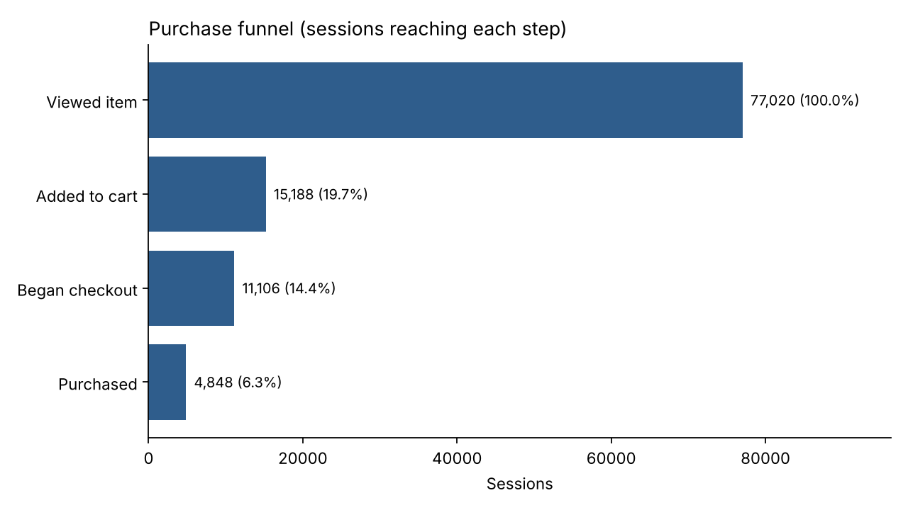
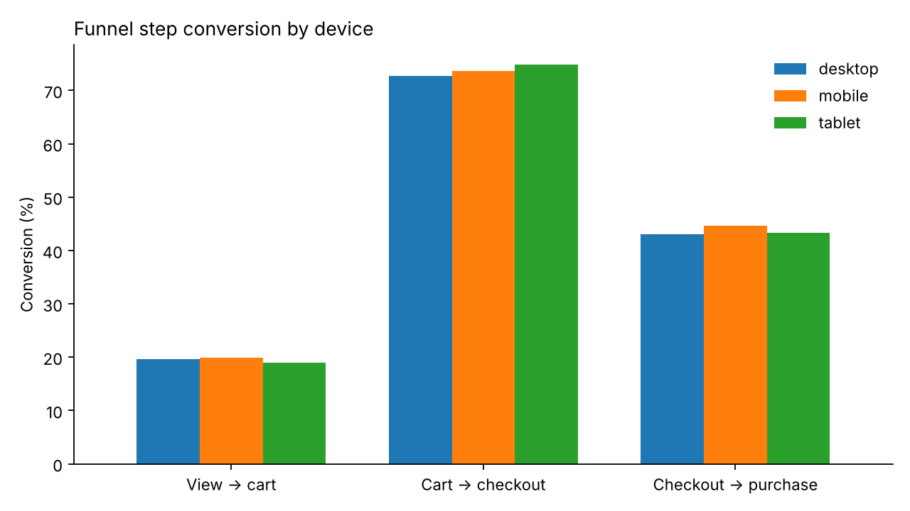
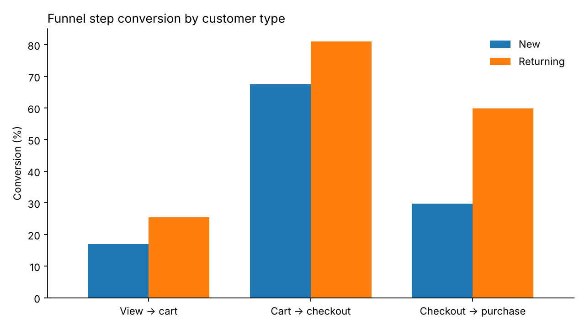
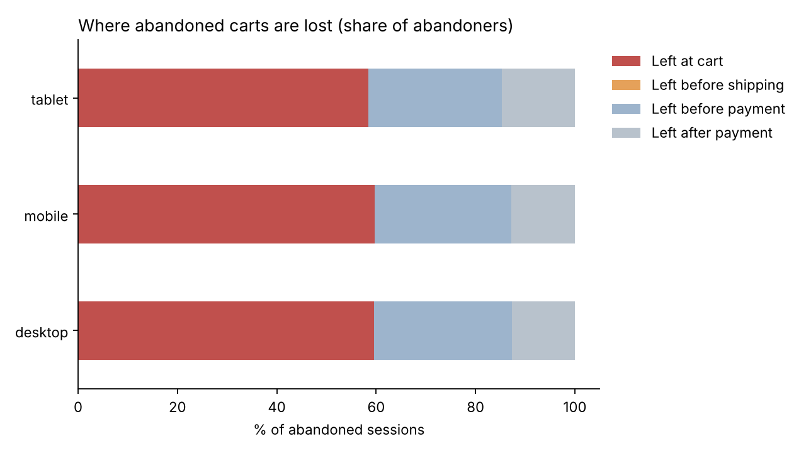
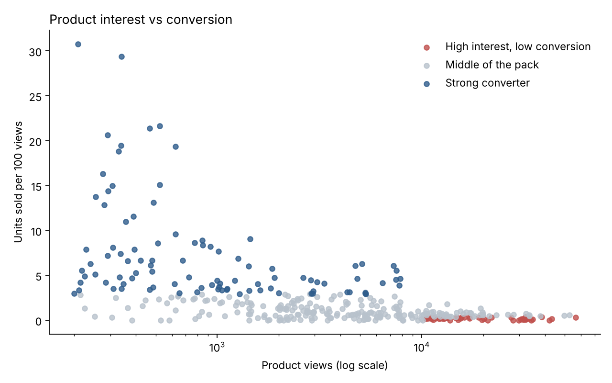
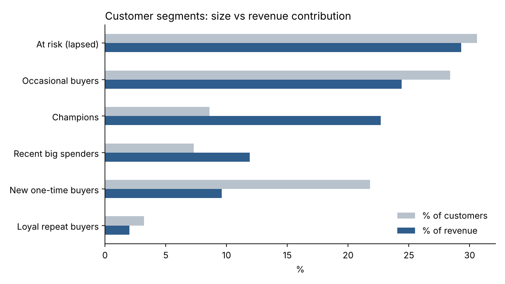

# Online Shopper Journey & Conversion Analysis (GA4)

Analysing Google Analytics 4 ecommerce event data to understand how online shoppers browse, compare and buy, where they drop out of the purchase journey, and what a retailer could do about it.

**Tools:** Google Analytics 4 data model · BigQuery (SQL) · Python (pandas, matplotlib) · Tableau

---

## Business questions

1. Where in the purchase journey do shoppers drop off: product view, cart, checkout or payment?
2. Does the journey work differently on mobile vs desktop, by traffic channel, or for new vs returning customers?
3. Which products attract interest but don't sell, and which convert consistently?
4. Who are the most valuable customers, and how does their browsing differ from everyone else's?
5. Can the tracking data be trusted, and what would need fixing?

## Data

Google's public **GA4 obfuscated sample ecommerce dataset** (`bigquery-public-data.ga4_obfuscated_sample_ecommerce`), exported from the Google Merchandise Store. It covers **1 November 2020 – 31 January 2021** and contains raw GA4 events (`page_view`, `view_item`, `add_to_cart`, `begin_checkout`, `purchase` and more) with device, traffic source and item details.

Some values are obfuscated by Google for privacy (e.g. `(data deleted)` traffic sources), which the data quality check measures.

## Approach

| Step | File | What it does |
|---|---|---|
| 1 | `sql/01_data_quality.sql` | Checks for missing session IDs, duplicate events, unassigned traffic and purchases without a transaction ID |
| 2 | `sql/02_funnel_by_segment.sql` | Builds a session-level funnel and compares step conversion by device, channel and new vs returning |
| 3 | `sql/03_cart_abandonment.sql` | Measures cart abandonment and where abandoners stop (cart, shipping, payment) |
| 4 | `sql/04_product_performance.sql` | Ranks products by views vs conversion and flags "high interest, low conversion" items |
| 5 | `sql/05_rfm_segments.sql` | Segments buyers by recency, frequency and spend, then profiles their browsing |
| 6 | `src/run_analysis.py` | Runs all queries, saves results to `outputs/data/`, draws charts to `outputs/charts/` |

## Results

> _Fill this section in from `outputs/data/*.csv` after running the analysis. Use your real numbers._

### Data quality
- _e.g. X% of events had unassigned or obfuscated traffic sources, so channel results are indicative only._

### Funnel

- _Biggest drop-off: between ___ and ___ (___% of sessions continue)._

### Device and customer type


- _Mobile vs desktop: ..._
- _New vs returning: ..._

### Cart abandonment

- ____% of carts were abandoned; most abandoners left at ___._

### Products

- _High-interest, low-conversion examples: ..._

### Customer segments

- ____ make up ___% of buyers but ___% of revenue._

## Recommendations

> _Write 3–4 recommendations that follow from your results. Examples of the kind of thing to write:_
- _Simplify the mobile checkout step with the largest drop-off._
- _Review pricing, imagery or stock for high-interest, low-conversion products._
- _Target lapsed customers with a re-engagement campaign._
- _Fix the tracking gaps found in the data quality check._

## Dashboard

_Add a link to your Tableau Public dashboard here, built from the CSVs in `outputs/data/`._

## How to run

See [`docs/how_to_run.md`](docs/how_to_run.md). In short:

```bash
pip install -r requirements.txt
gcloud auth application-default login
python src/run_analysis.py --project YOUR_GCP_PROJECT_ID
```

## Limitations

- The dataset is obfuscated sample data from one online store over three months, including the Christmas peak.
- Funnel steps are counted per session ("did this session ever fire the event"), not in strict order.
- RFM uses only purchases within the dataset window.
