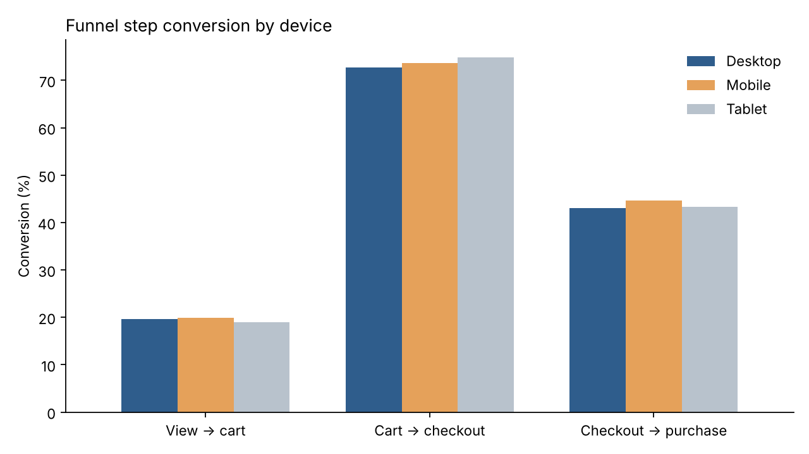
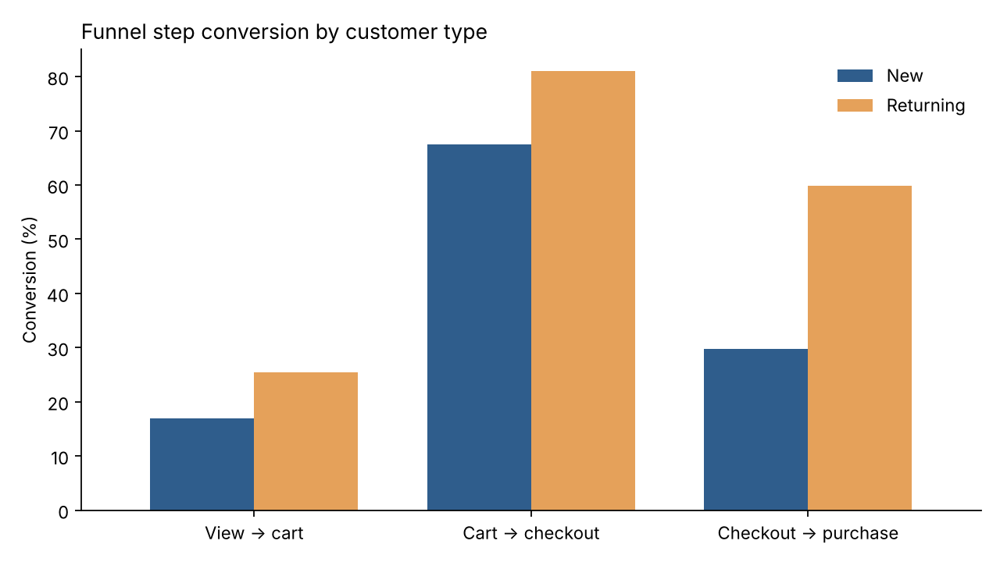
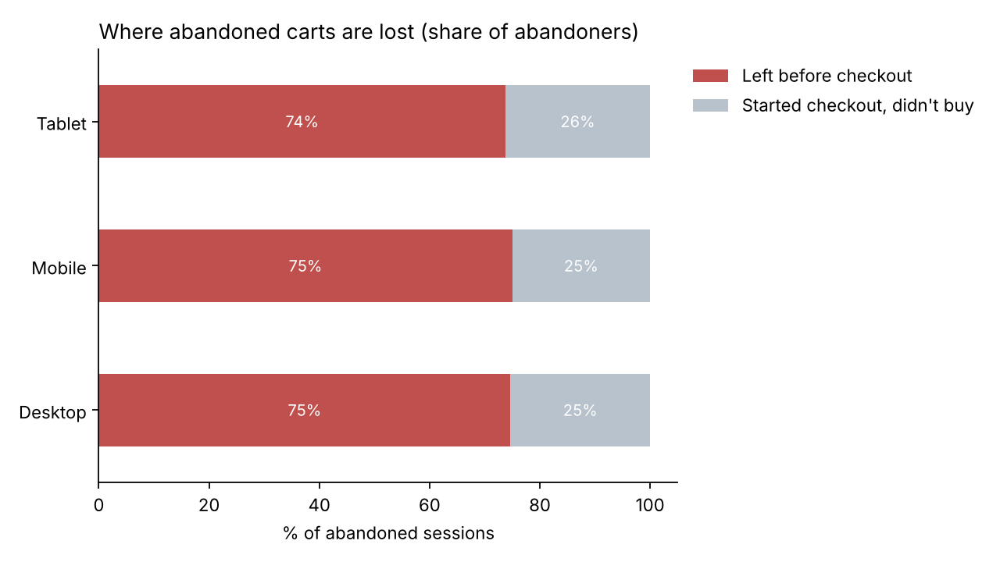

# Online Shopper Journey & Conversion Analysis (GA4)

Analysing Google Analytics 4 ecommerce event data to understand how online shoppers browse, compare and buy, where they drop out of the purchase journey, and what a retailer could do about it.

**Tools:** Google Analytics 4 data model · BigQuery (SQL) · Python (pandas, matplotlib)

---

## Business questions

1. Where in the purchase journey do shoppers drop off: product view, cart, checkout or payment?
2. Does the journey work differently on mobile vs desktop, by traffic channel, or for new vs returning customers?
3. Which products attract interest but don't sell, and which convert consistently?
4. Who are the most valuable customers, and how does their browsing differ from everyone else's?
5. Can the tracking data be trusted, and what would need fixing?

## Data

Google's public **GA4 obfuscated sample ecommerce dataset** (`bigquery-public-data.ga4_obfuscated_sample_ecommerce`), exported from the Google Merchandise Store. It covers **1 November 2020 – 31 January 2021** and contains raw GA4 events (`page_view`, `view_item`, `add_to_cart`, `begin_checkout`, `purchase` and more) with device, traffic source and item details.

Some values are obfuscated by Google for privacy (e.g. `(data deleted)` traffic sources), which the data quality check measures.

## Approach

| Step | File | What it does |
|---|---|---|
| 1 | `sql/01_data_quality.sql` | Checks for missing session IDs, duplicate events, unassigned traffic and purchases without a transaction ID |
| 2 | `sql/02_funnel_by_segment.sql` | Builds a session-level funnel and compares step conversion by device, channel and new vs returning |
| 3 | `sql/03_cart_abandonment.sql` | Measures cart abandonment and where abandoners stop (cart, shipping, payment) |
| 4 | `sql/04_product_performance.sql` | Ranks products by views vs conversion and flags "high interest, low conversion" items |
| 5 | `sql/05_rfm_segments.sql` | Segments buyers by recency, frequency and spend, then profiles their browsing |
| 6 | `src/run_analysis.py` | Runs all queries, saves results to `outputs/data/`, draws charts to `outputs/charts/` |

## Key findings

- **Returning customers convert 4.6x better than new ones** (3.10% vs 0.68% of sessions). The biggest gap is at checkout: only **29.8%** of new customers who start checkout finish, vs **59.8%** of returning customers.
- **Over half of checkouts fail.** 43.7% of sessions that begin checkout end in a purchase, so the late funnel leaks more value than any other stage.
- **Mobile is not the problem.** Mobile (1.39%) and desktop (1.32%) convert almost identically at every step.
- **Several best-browsed products never sold.** Women's Striped L/S: 42,142 views, 11,847 add-to-carts, **0 sales**, a pattern pointing to stock or tracking issues rather than lack of demand.
- **8.6% of buyers (Champions) bring 22.7% of revenue**, while 30.6% of buyers are lapsing.

## Results

### Data quality
| Check | Result |
|---|---|
| Events missing a session ID | 0 of 4.3M (0%) |
| Duplicate events (same user, event and timestamp) | 0 |
| Purchase events missing a transaction ID | 906 (0.02% of events) |
| Sessions with an obfuscated traffic source (`(data deleted)`) | 22,629 of 360,129 (6.3%) |

- Event tracking is clean: every event has a session ID and there are no double-fired events.
- **6.3% of sessions have their traffic source obfuscated**, so channel comparisons are indicative. That hidden group shows the highest conversion of any channel (3.12%), so the true performance of some channels is likely understated.
- Direct traffic (23.2% of sessions) is a valid channel and is analysed as its own group, not treated as missing data.

### Funnel


Of **360,129 sessions**, 77,020 viewed a product and 4,848 purchased (1.35% session conversion).

| Step | Continue to next step |
|---|---|
| View item → add to cart | 19.7% |
| Add to cart → begin checkout | 73.1% |
| Begin checkout → purchase | 43.7% |

Browsing-to-cart is the largest drop in volume, which is normal for retail. The more costly leak is **checkout**: 56% of shoppers who have shown clear buying intent by starting checkout still don't buy.

### Device and customer type


- Desktop 1.32%, mobile 1.39%, tablet 1.30%. Step-by-step rates differ by only 1–2 points, so the experience performs consistently across devices.



- New customers make up **73% of sessions** but only **37% of purchasing sessions**.
- Returning customers outperform at every step, most of all at checkout (59.8% vs 29.8% complete). First-time buyers appear to hit friction a returning customer has already overcome, such as creating an account, entering details or uncertainty about shipping and returns.

**By channel:** referral traffic converts best (1.66%); organic search (1.10%) and paid search (0.98%) trail, with paid search weakest at every step.

### Cart abandonment


- **81.2%** of sessions with an add-to-cart did not purchase (12,340 of 15,188).
- About **75%** of abandoners never started checkout, consistent on desktop (75%), mobile (75%) and tablet (74%). Many shoppers use the cart as a wishlist or leave once they see the total. The remaining 25% started checkout and left before completing it.

### Products


**High interest, low conversion.** Some of the most-viewed products, many added to cart thousands of times, sold nothing:

| Product | Views | Add-to-carts | Units sold |
|---|---|---|---|
| Google Women's Striped L/S | 42,142 | 11,847 | 0 |
| Google F/C Long Sleeve Tee Charcoal | 34,275 | 9,551 | 0 |
| Google F/C Long Sleeve Tee Ash | 27,987 | 9,137 | 0 |
| Google Eco Tee Black | 20,989 | 5,124 | 0 |
| Google Land & Sea Unisex Tee | 13,747 | 3,098 | 0 |

The most-viewed product overall, Google Navy Speckled Tee (56,466 views), sold just 0.32 units per 100 views. Thousands of add-to-carts with zero sales usually means a product could not actually be bought (out of stock, unavailable sizes) or a purchase-tracking gap, not a lack of demand.

**Strong converters** are mostly low-price, low-risk items such as campus mugs, pens, stickers and keychains, several selling 15–30 units per 100 views.

### Customer segments


| Segment | % of buyers | % of revenue | Avg spend | Items viewed |
|---|---|---|---|---|
| Champions | 8.6% | 22.7% | $234 | 41.0 |
| Recent big spenders | 7.3% | 11.9% | $146 | 29.6 |
| At risk (lapsed) | 30.6% | 29.3% | $85 | 18.9 |
| Occasional buyers | 28.4% | 24.4% | $77 | 23.9 |
| New one-time buyers | 21.8% | 9.6% | $39 | 18.4 |
| Loyal repeat buyers | 3.2% | 2.0% | $55 | 23.1 |

- Champions spend **2.6x** the average buyer ($234 vs $89) and view **1.8x** as many products (41 vs 23), so engagement on site signals value.
- Only **11.8%** of 3,713 buyers purchased more than once. Most of the customer base is one-time.

## Recommendations

1. **Fix checkout for first-time customers.** The biggest gap in the data is new vs returning at checkout (29.8% vs 59.8%). Test guest checkout, showing shipping costs and returns policy earlier, and fewer form fields.
2. **Audit high-interest products with zero sales.** Check stock and size availability and purchase tracking for items like the Women's Striped L/S. If they were unavailable, add back-in-stock alerts to capture that demand.
3. **Turn one-time buyers into repeat buyers.** With 88% of buyers purchasing once, a post-purchase email journey and targeted offers for "At risk" customers (avg 68 days since purchase) protect nearly 30% of revenue.
4. **Recover traffic attribution.** 6.3% of sessions, which also convert best, have no visible source. Consistent UTM tagging and consent-mode configuration would make channel decisions, especially paid search spend, more reliable.
5. **Use cart reminders.** With 75% of abandoners leaving before checkout, cart-reminder emails and saved carts for signed-in users are a low-cost way to recover sales.

## How to run

See [`docs/how_to_run.md`](docs/how_to_run.md). In short:

```bash
pip install -r requirements.txt
gcloud auth application-default login
python src/run_analysis.py --project YOUR_GCP_PROJECT_ID
```

## Limitations

- The dataset is obfuscated sample data from one online store over three months, including the Christmas peak.
- Funnel steps are counted per session ("did this session ever fire the event"), not in strict order.
- RFM uses only purchases within the dataset window.
- Products with many add-to-carts but zero recorded sales may reflect unavailable stock or a gap between item names in cart and purchase events; the data alone can't separate the two.
